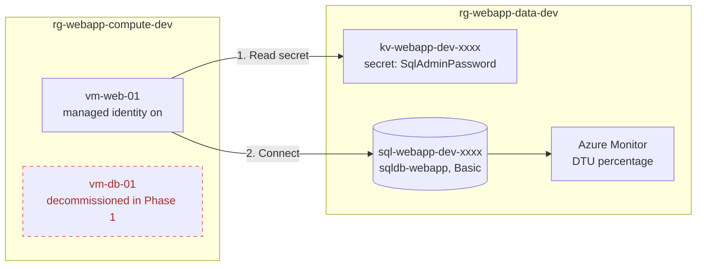

# Azure PaaS Modernization and Secret Management with Terraform

**Status:** 🚧 In progress: Terraform written, not yet deployed.
<!-- When done: ✅ Complete: built, tested, and deployed on Azure (East US) entirely with Terraform. -->

## Video Walkthrough

> 🎥 Loom walkthrough coming soon.

## Project Overview

I rebuilt a portal-based Azure lab, *Modernizing to PaaS and Securing Secrets*, entirely in Terraform. It starts as a two-tier web app: a web VM and a self-managed database VM. Then it decommissions the database VM, replaces it with Azure SQL Database in a separate resource group, stores the SQL admin password in Azure Key Vault, and gives the web VM a managed identity that can read that secret without any stored credentials.

The code is split into two layers, each with its own `main.tf` and its own state:

- **`compute/`** builds `rg-webapp-compute-dev`: the network and both VMs.
- **`data/`** builds `rg-webapp-data-dev`: Azure SQL, Key Vault, the secret, and the role assignments.

How credentials are handled:

- **Web VM to Key Vault:** vm-web-01 uses a system-assigned managed identity. Azure creates and rotates its credential, so nothing is stored on the VM.
- **Key Vault permissions:** the vault uses Azure RBAC. Two role assignments are scoped to the vault itself: Key Vault Administrator for me, and Key Vault Secrets User for the VM.
- **SQL admin password:** this is the one secret. It's passed in through an environment variable (`TF_VAR_sql_admin_password`), and the same apply writes it to the SQL server and to Key Vault. It never appears in code or tfvars. It does end up in the data layer's state, so state stays local and gitignored.

### Skills Demonstrated

- **Terraform on Azure:** the azurerm provider 4.x, provider `features` for OS disk deletion and Key Vault purge on destroy, sensitive variables, and preconditions.
- **Layered state:** separate root modules for compute and data, so a change in one layer can't destroy the other.
- **Cross-layer lookups:** the data layer finds vm-web-01 with a `data` block instead of sharing state.
- **Naming conventions:** a `type-workload-environment` pattern, with a `random_string` suffix for globally unique names.
- **Decommissioning with IaC:** removing resources from code and confirming in the plan that only the intended resources are destroyed.
- **IaaS to PaaS migration pattern:** replacing a self-managed database VM with Azure SQL Database on the Basic DTU tier.
- **Managed identity and RBAC:** a system-assigned identity plus role assignments scoped to a single Key Vault, following least privilege.
- **Handling RBAC propagation:** a `time_sleep` after the role assignment so the secret write doesn't fail with "unauthorized by RBAC."
- **Observability:** checking database health with the Azure Monitor DTU percentage metric, in the portal and with the Azure CLI.

## Architecture Diagram



At runtime, vm-web-01 uses its managed identity to read the SQL password from Key Vault (1), then connects to the database with it (2). The database reports its metrics to Azure Monitor. vm-db-01 exists only in the starting two-tier app and is removed in Phase 1.

## Prerequisites

- An Azure subscription where I can create role assignments (Owner, or User Access Administrator plus Contributor)
- Terraform 1.5 or later, the Azure CLI, Git, VS Code
- An SSH key pair for the Linux VMs (`ssh-keygen -t rsa -b 4096`)
- macOS with zsh

## Naming Conventions

Names follow `type-workload-environment`. The SQL server and Key Vault names have to be unique across all of Azure, so they end in a 4-character random suffix (`xxxx`) that Terraform generates once and keeps in state.

| Resource | Name |
|---|---|
| Compute resource group | `rg-webapp-compute-dev` |
| Data resource group | `rg-webapp-data-dev` |
| Virtual network / subnet / NSG | `vnet-webapp-dev` / `snet-web` / `nsg-web` |
| Web VM | `vm-web-01` (kept) |
| Database VM | `vm-db-01` (decommissioned in Phase 1) |
| SQL server | `sql-webapp-dev-xxxx` |
| SQL database | `sqldb-webapp` |
| Key Vault | `kv-webapp-dev-xxxx` |
| Secret | `SqlAdminPassword` |
| SQL admin login | `sqladmin` |
| Region | East US (`eastus`) |

## Project Steps

### 1. Create the repository

```bash
mkdir webapp-paas-terraform && cd webapp-paas-terraform
git init -b main
git remote add origin https://github.com/clevelandjosiah/<REPO_NAME>.git
```

I committed `.gitignore` first, so state files, tfvars, and the `.terraform/` folders could never reach GitHub. `.terraform.lock.hcl` is deliberately not ignored, because it pins provider versions.

### 2. Configure Terraform

```
webapp-paas-terraform/
  compute/
    main.tf                   rg-webapp-compute-dev, network, vm-web-01, vm-db-01
    variables.tf
    outputs.tf
    terraform.tfvars.example
  data/
    main.tf                   rg-webapp-data-dev, SQL, Key Vault, secret, role assignments
    variables.tf
    outputs.tf
    terraform.tfvars.example
```

Each folder is its own Terraform project with its own state. Terraform reads every `.tf` file in the folder you run it from, so `compute` and `data` are planned and applied separately.

A few decisions worth calling out:

```hcl
data "azurerm_virtual_machine" "web" {
  name                = "vm-web-01"
  resource_group_name = "rg-${local.workload}-compute-${local.environment}"
}
```

The data layer can't see the compute layer's state, so it looks vm-web-01 up by name. That's how it gets the VM's identity for the Phase 5 role assignment.

```hcl
dynamic "identity" {
  for_each = var.enable_web_identity ? [1] : []
  content { type = "SystemAssigned" }
}
```

```hcl
resource "azurerm_role_assignment" "vm_secrets_user" {
  count = var.grant_vm_access ? 1 : 0
  ...
}
```

Phase 5 is controlled by two variables: `enable_web_identity` in compute and `grant_vm_access` in data. Turning them on updates vm-web-01 in place instead of rebuilding it. A precondition stops the data plan with a clear message if the VM doesn't have an identity yet.

```hcl
features {
  virtual_machine { delete_os_disk_on_deletion = true }    # compute
  key_vault       { purge_soft_delete_on_destroy = true }  # data
}
```

The first setting makes sure the OS disk goes with vm-db-01 in Phase 1. The second lets cleanup fully remove the vault, which works because purge protection stays off.

Set up both folders once:

```bash
az login
az account set --subscription <SUBSCRIPTION_ID>
cp compute/terraform.tfvars.example compute/terraform.tfvars   # fill in subscription and client IP
cp data/terraform.tfvars.example data/terraform.tfvars         # same values
```

### 3. Step 0: Build the two-tier app (compute)

```bash
cd compute
terraform init
terraform fmt
terraform validate
terraform plan -out=tfplan
terraform apply tfplan
```

What it creates:

- **rg-webapp-compute-dev** with `vnet-webapp-dev`, `snet-web`, and `nsg-web` (SSH allowed only from my IP)
- **vm-web-01:** Ubuntu 22.04, with a public IP and no managed identity yet
- **vm-db-01:** Ubuntu 22.04, private only, with its NIC and OS disk

<!-- RESULT: record the plan count, e.g. "The plan created N resources." -->


### 4. Phase 1: Decommission vm-db-01 (compute)

In a real migration, the data moves first and the old server is shut down last. This step simulates that final decommission. In Terraform, decommissioning means deleting the resources from code and letting the plan prove what gets destroyed.

In `compute/main.tf`, I deleted everything between the `BEGIN vm-db-01` and `END vm-db-01` markers, then:

```bash
terraform plan -out=tfplan
terraform apply tfplan
```

The plan should show **2 to destroy**: `azurerm_linux_virtual_machine.db` and `azurerm_network_interface.db`. The portal walkthrough deletes three resources, but Terraform manages the OS disk as part of the VM, so the disk is deleted with it rather than shown as a separate resource. Nothing for vm-web-01 should appear in the plan.

<!-- RESULT: confirm the plan count and that vm-web-01 was untouched. -->


### 5. Phases 2 to 4: Build the data layer (data)

```bash
cd ../data
export TF_VAR_sql_admin_password='<strong password>'
terraform init
terraform fmt
terraform validate
terraform plan -out=tfplan
terraform apply tfplan
```

One apply builds the SQL server, the database, Key Vault, my admin role, and the secret. Terraform works out the order from the dependencies.

**Phase 2: Azure SQL Database.** How the walkthrough's portal settings map to Terraform:

| Portal setting | Terraform |
|---|---|
| Authentication: Use SQL authentication | `administrator_login = "sqladmin"`, no `azuread_administrator` block |
| Service tier: Basic (DTU) | `sku_name = "Basic"`, `max_size_gb = 2` |
| Backup storage: LRS | `storage_account_type = "Local"` |
| Connectivity: Public endpoint | `public_network_access_enabled = true` |
| Allow Azure services: Yes | Firewall rule `0.0.0.0` to `0.0.0.0` |
| Add current client IP: Yes | Firewall rule for `var.client_ip` |
| Minimum TLS: 1.2 | `minimum_tls_version = "1.2"` |
| Defender for SQL: Not now | Not configured |
| Collation: default | `SQL_Latin1_General_CP1_CI_AS` |

**Phase 3: Azure Key Vault.**

| Setting | Value | Why |
|---|---|---|
| Pricing tier | Standard | Secrets only, no HSM needed |
| Permission model | Azure RBAC (`enable_rbac_authorization = true`) | Same permission system as every other Azure resource |
| Soft delete | 90 days | Azure enforces it |
| Purge protection | Off | So cleanup can fully delete the vault |
| Public access | All networks | Simple for a lab; access is still controlled by RBAC |

With RBAC, nobody can read or write secrets by default, including whoever created the vault. The apply gives me **Key Vault Administrator**, then waits 90 seconds for it to take effect.

**Phase 4: the secret.** After the wait, the apply stores `SqlAdminPassword` with the same value the SQL server received. There's no content type, activation date, or expiration date, matching the walkthrough.

<!-- RESULT: record the plan count and whether the 90-second wait was enough. -->


### 6. Phase 5: Managed identity and Key Vault access (compute, then data)

**Part A: turn on the identity.** In `compute/terraform.tfvars`, set `enable_web_identity = true`:

```bash
cd ../compute
terraform plan -out=tfplan
terraform apply tfplan
terraform output web_identity_principal_id
```

The plan should show **1 to change**: vm-web-01 updated in place, not replaced.

**Part B: grant the role.** In `data/terraform.tfvars`, set `grant_vm_access = true`:

```bash
cd ../data
terraform plan -out=tfplan
terraform apply tfplan
```

The plan should show **1 to add**: the role assignment.

| Principal | Role | Scope |
|---|---|---|
| My account | Key Vault Administrator | `kv-webapp-dev-xxxx` |
| vm-web-01 managed identity | Key Vault Secrets User | `kv-webapp-dev-xxxx` |

The role assignment lives on the Key Vault and names the VM's identity. The identity itself holds no permissions. It only proves who the VM is.

<!-- RESULT: confirm the in-place update and record that an Object (principal) ID was output. -->


### 7. Phase 6: Validate with Azure Monitor

Nothing to deploy. I checked the database's DTU percentage in **sqldb-webapp → Monitoring → Metrics** with Max aggregation, and from the CLI in the `data` folder:

```bash
az monitor metrics list \
  --resource $(terraform output -raw sql_database_id) \
  --metric dtu_consumption_percent \
  --aggregation Maximum \
  --interval PT5M
```

A line on the chart, even near zero, confirms the database is live and reporting to Azure Monitor.


## Verification Checklist

- [ ] vm-db-01, its OS disk, and its NIC were destroyed, and the plan showed nothing else
- [ ] vm-web-01 is still running in `rg-webapp-compute-dev`
- [ ] `sqldb-webapp` is deployed on the Basic tier in `rg-webapp-data-dev`
- [ ] `kv-webapp-dev-xxxx` uses the RBAC permission model with purge protection off
- [ ] `SqlAdminPassword` exists and is Enabled
- [ ] vm-web-01 has a system-assigned identity with an Object (principal) ID
- [ ] vm-web-01 has Key Vault Secrets User scoped to the vault only
- [ ] The DTU percentage metric shows a line for `sqldb-webapp`
- [ ] No password appears in code, tfvars, or Git history

## Troubleshooting

| Issue | Cause | Fix |
|---|---|---|
| | | |

<!-- Fill this in as issues come up. Ones to watch for:
- Secret write fails with "unauthorized by RBAC": the role hasn't propagated yet; rerun apply
- Data plan fails reading vm-web-01: compute hasn't been applied, or the names don't match
- Key Vault name in use after a destroy: a soft-deleted vault still holds the name; purge it
- Role assignment fails with AuthorizationFailed: your account lacks Owner or User Access Administrator
- file() error on the SSH key: check ssh_public_key_path
-->

## Cleanup

Destroy the data layer first, because it depends on the compute layer:

```bash
cd data
terraform destroy
cd ../compute
terraform destroy
unset TF_VAR_sql_admin_password
```

This removes both resource groups. The Key Vault is purged after deletion because purge protection is off.

## Key Takeaways

<!-- Draft. Revise with what actually happened. -->

- **Decommissioning in Terraform is a code deletion, not a click.** The plan is the safety check: it should list only the resources being retired.
- **Separate state per layer limits the blast radius.** The data layer can't touch the VMs, and the compute layer can't touch the database.
- **A managed identity answers "who," and RBAC answers "what."** The role assignment lives on the Key Vault and names the identity. Without that assignment, a valid token still gets a 403.
- **RBAC on Key Vault starts with zero access,** even for the person who created it. The admin role and a short wait have to come before the first secret write.
- **Removing hardcoded credentials isn't the same as removing secrets.** The password still exists and still lands in state. The next step is Entra authentication to SQL, so the VM connects with its identity and no password exists at all.

---

Built by **Anthony Cleveland** · Cloud Engineer · [github.com/clevelandjosiah](https://github.com/clevelandjosiah)
